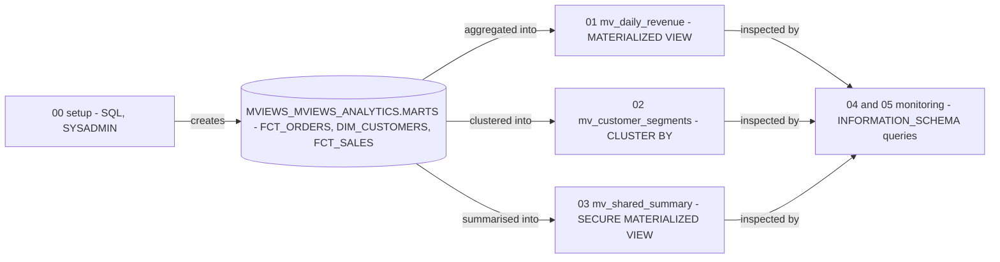

# Snowflake Materialised Views - Architecture and design rationale

*Last updated: 2026-11-07 · commit 2edefc322*

## 1. Purpose and scope

A learning tutorial on Snowflake materialised views: a basic aggregate view, a clustered view, a secure view meant for
sharing, and the system queries that show refresh history and storage. It is for someone comparing materialised views
with ordinary views and dynamic tables and wanting to see the syntax and the monitoring queries.

It is not a performance study. Five-row tables cannot demonstrate any speed-up, and nothing in the repository measures
one. The repository does not say what kind of account the material was run on (`TODO: verify`).

## 2. How this project was built

This project was built with Claude Code (Anthropic's AI coding assistant) in a complementary role. Elliott Fairhall is
the author and owner: the project is debugged, tested and used by him for learning and development, and the design
decisions below are explained so that they can be understood, questioned and learned from. AI assistance does not
replace that work. The repository does not record how much of each script was run or reviewed, so the document makes no
claim about that beyond the statement above.

## 3. Architecture at a glance

Three base tables feed three views, each over exactly one table. Snowflake maintains the views with serverless compute
(stated in the README and tutorial), so no warehouse appears in the scripts for maintenance.

## 4. Learning path

| Order | Script                          | Teaches                                                               | Why here                                                                       |
| ----- | ------------------------------- | --------------------------------------------------------------------- | ------------------------------------------------------------------------------ |
| 00    | `00_setup_environment.sql`      | Three small tables in `MVIEWS_ANALYTICS.MARTS`                        | Each view needs its own single source table                                    |
| 01    | `01_basic_view_setup.sql`       | `CREATE MATERIALIZED VIEW` over a grouped aggregate, then querying it | Baseline: daily revenue, the textbook case for pre-computation                 |
| 02    | `02_clustered_view.sql`         | `CLUSTER BY` on a materialised view                                   | Optimisation, introduced after the learner has a view to optimise              |
| 03    | `03_secure_view_sharing.sql`    | `SECURE MATERIALIZED VIEW`                                            | Governance variant; links to the sharing tutorial                              |
| 04    | `04_maintenance_monitoring.sql` | `MATERIALIZED_VIEW_REFRESH_HISTORY`, suspend and resume (commented)   | Maintenance cost is the price of the feature, so it follows the creation steps |
| 05    | `05_storage_monitoring.sql`     | Size of each view from `INFORMATION_SCHEMA.TABLES`                    | The other cost: storage                                                        |

The order is build, optimise, secure, then observe the two costs. Putting costs last mirrors how the tutorial's
"Limitations and Considerations" section follows its feature description. Why each view uses a different source table is
inferred (section 10).

## 5. Isolation, idempotency and cleanup

- **Isolation:** namespaced (changed 2026-11-07). Script 00 runs `CREATE OR REPLACE TABLE` on `FCT_ORDERS`,
  `DIM_CUSTOMERS` and `FCT_SALES` in `MVIEWS_ANALYTICS.MARTS`. The `MVIEWS_` prefix stops them colliding with the
  same-named tables, with different columns, in the Data Sharing and Data Masking tutorials. A re-run replaces this
  tutorial's own tables.
- **Re-running:** every view uses `CREATE OR REPLACE`. Replacing a materialised view discards the maintained result, and
  it is rebuilt, which uses serverless credits (`TODO: verify` billing detail).
- **Cleanup:** none. No script drops the views, tables or database, and the `notebook/` file is empty (section 8).
- **Cost and safety:** maintenance and storage are billed for as long as a view exists, even on tiny tables. Invented
  rows only.

## 6. Design rationale

### One view per script, each over its own table

- **Why:** the single-table restriction is the defining limit of the feature (stated in the tutorial: no joins, and "use
  dynamic tables for multi-table queries"). Three tables make that visible: each view is a plain aggregate of one table.
- **Gave up:** the tutorial's strongest comparison, a view that cannot be built because it needs a join, is described in
  prose only and no script demonstrates the failure.
- **Alternative not taken:** a failing `CREATE` as a teaching step. That would leave the folder with a script that
  errors.
- **Evidence:** documented (tutorial section on limitations).

### Clustering shown on a three-row table

- **Why (reconstructed):** it shows the syntax in one clause. The README frames clustering as for "massive datasets".
- **Gave up:** clustering has no measurable effect, and carries its own maintenance cost, on three rows.
- **Alternative not taken:** a generated larger table. It would add setup and credits.
- **Evidence:** documented (README) for the intent; the rest inferred.

### A secure materialised view named for sharing, without any share

- **Why:** the secure variant is the form needed to put a view into a share. `03_secure_view_sharing.sql` creates one,
  and the Data Sharing tutorial covers shares.
- **Gave up:** the script name promises sharing, but no share is created or granted here.
- **Alternative not taken:** include the share steps. That duplicates the Data Sharing tutorial.
- **Evidence:** inferred from the code.

### Monitoring through `INFORMATION_SCHEMA`

- **Why:** the refresh-history table function and the tables view are available in the current database without extra
  privileges on the `SNOWFLAKE` database, and are near real-time compared with account-level views (`TODO: verify`).
- **Gave up:** they only see the current database and a limited history window (`TODO: verify` retention); no credit
  figures are shown. Script 05 filters on the schema name `MARTS` only, so it depends on `MVIEWS_ANALYTICS` being the
  current database.
- **Alternative not taken:** `ACCOUNT_USAGE` views, which cover the whole account but lag.
- **Evidence:** inferred from the code.

### Edition requirement stated, not checked

- **Why:** the tutorial says materialised views need Enterprise Edition or above (`TODO: verify` against current
  documentation).
- **Gave up:** no script checks for support. On a lower edition the first `CREATE` fails.
- **Alternative not taken:** a pre-flight check script.
- **Evidence:** documented.

### Trade-offs against production practice

| Tutorial choice                       | Production practice                                                               |
| ------------------------------------- | --------------------------------------------------------------------------------- |
| Views over five-row tables            | Views only on large, frequently queried tables with expensive repeated aggregates |
| `CREATE OR REPLACE MATERIALIZED VIEW` | Avoid replacing a view that is in use; each rebuild costs credits                 |
| No cost guardrails                    | Resource monitoring and a review of whether maintenance cost beats query saving   |
| Dynamic tables only named in prose    | Evaluate dynamic tables when a join is needed                                     |

## 7. Quality and testing

No automated tests. Nothing in the repository records an expected output or a verified run (`TODO: verify`). A learner
can check that each view returns rows and that script 04 shows refresh entries.

## 8. Constraints, limitations and known gaps

- `notebook/Materialised_Views_Tutorial.ipynb` contains no cells; the README presents it as part of the project.
- No cleanup.
- Script 00 is not listed in the README's structure tree, but the README tells the learner to run it first.
- Script 04's suspend and resume lines are commented out.
- No warehouse is set; queries need a current warehouse.
- Scripts 04 and 05 only work when the current database is `MVIEWS_ANALYTICS`.
- Clustering and secure views are shown without any data volume that would justify them.
- The tutorial's statements about edition, supported SQL and maintenance behaviour have not been re-checked
  (`TODO: verify`).

## 9. Running and extending

See the [README](../README.md) and the [tutorial](../Tutorial/MATERIALISED_VIEWS_TUTORIAL.md). If you extend it, give
the tutorial its own database, add a teardown script that drops every view, and keep one source table per view. Either
fill the notebook or remove it from the README in the same change.

## 10. Rationale (confirmed by the owner)

Confirmed by Elliott Fairhall on 2026-11-07. This reasoning was first reconstructed from the code and commit history;
the owner has since agreed it is correct, so it is now the stated rationale rather than an inference.

- Each view has its own base table to make the single-table limit obvious without a failing example.
- Clustering and secure views are included as syntax illustrations, not as justified optimisations at this size.
- `INFORMATION_SCHEMA` was chosen for monitoring because it needs no extra privileges and is immediate.
- The empty notebook is a placeholder from the project template rather than a deliberate omission.
- The generic `ANALYTICS` database was originally reused across tutorials for convenience on an account where it was
  free (confirmed by the owner). It is now `MVIEWS_ANALYTICS` (changed 2026-11-07).
- The account used was a personal or trial-style one (confirmed by the owner).
